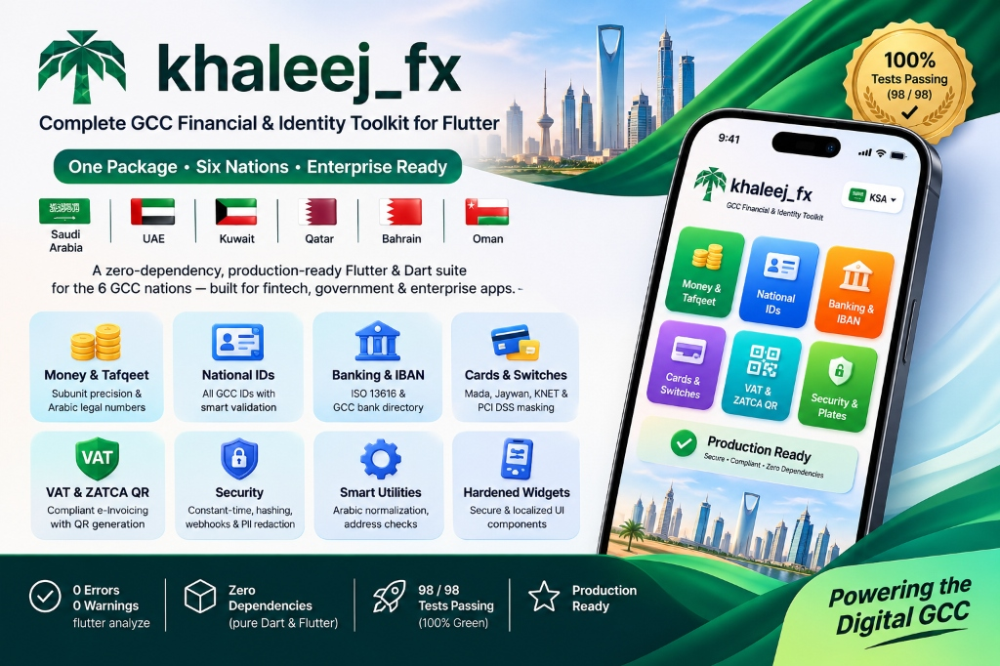

# Khaleej FX (خـلـيـج FX) 🇸🇦 🇦🇪 🇰🇼 🇶🇦 🇧🇭 🇴🇲

<p align="center">
  
</p>

[](https://pub.dev)
[](https://dart.dev)
[](https://flutter.dev)
[](https://opensource.org/licenses/MIT)
[](#)

An enterprise-grade, high-precision GCC Fintech, Banking, Identity, VAT, and Utilities library engineered for Flutter and Dart. Designed specifically for financial institutions, payment gateways, e-commerce, and government-grade digital apps across all six Gulf Cooperation Council member states:

- 🇸🇦 **Saudi Arabia** (المملكة العربية السعودية)
- 🇦🇪 **United Arab Emirates** (الإمارات العربية المتحدة)
- 🇰🇼 **Kuwait** (دولة الكويت)
- 🇶🇦 **Qatar** (دولة قطر)
- 🇧🇭 **Bahrain** (مملكة البحرين)
- 🇴🇲 **Oman** (سلطنة عمان)

---

## 🏛️ Architecture Overview

```mermaid
graph TD
    A[Khaleej FX Suite] --> B[Fixed-Point Money & Tafqeet]
    A --> C[GCC Identity & Civil Numbers]
    A --> D[ISO 13616 IBAN & Bank Directory]
    A --> E[Cards & Domestic Switches]
    A --> F[VAT & ZATCA e-Invoicing]
    A --> G[Fintech Security & PDPL Redaction]
    A --> H[Hardened UI Widgets & Plates]

    B --> B1[2 & 3 Decimals Subunit Precision]
    B --> B2[Grammar-Aware Arabic Tafqeet]

    C --> C1[Saudi National ID & Iqama Luhn]
    C --> C2[Emirates ID 784-YYYY-XXXXXXX-C]
    C --> C3[Kuwait Civil ID PACI Modulo 11]
    C --> C4[Qatar, Bahrain & Oman Civil IDs]

    D --> D1[ISO 7064 Mod 97-10 Checksum]
    D --> D2[GCC Bank Code to SWIFT/BIC Directory]

    E --> E1[Mada, Jaywan, KNET, Benefit, Himyan, OmanNet]
    E --> E2[PCI DSS 4.0 BIN-Preserving Masking]

    F --> F1[Inclusive / Exclusive & Intra-GCC B2B]
    F --> F2[ZATCA Phase 1 & 2 Base64 TLV Codec]

    G --> G1[TimingSafe Constant-Time Comparison]
    G --> G2[Pure-Dart RFC 6234 SHA-256 & HMAC]
    G --> G3[KSA & UAE PDPL PII Redaction]
```



---

## 🚀 Key Modules & Capabilities

### 1. `KhaleejMoney` & Subunit Precision Arithmetic
Traditional floating-point representations (`double`) suffer from binary representation inaccuracies (e.g. `0.1 + 0.2 != 0.3`). `KhaleejMoney` stores currency balances internally as integer sub-units (`BigInt`):
- **2 Decimals (`1/100`)**: SAR (Halala), AED (Fils), QAR (Dirham).
- **3 Decimals (`1/1000`)**: KWD (Fils), BHD (Fils), OMR (Baisa).

```dart
import 'package:khaleej_fx/khaleej_fx.dart';

// Create exact monetary values
final salary = KhaleejMoney.fromMajor(1250.75, KhaleejCurrency.sar);
final bonus = KhaleejMoney.fromMajor(250.50, KhaleejCurrency.sar);

// Exact arithmetic
final total = salary + bonus; // 1,501.25 SAR
final vat = total.percentage(15); // 225.19 SAR

// Formatting
print(total.format()); // '1,501.25 SAR'
print(total.format(useArabicSymbol: true)); // '1,501.25 ر.س'
print(total.format(useArabicNumerals: true)); // '١٬٥٠١٫٢٥ ر.س'
```

### 2. Tafqeet (Arabic & English Number-to-Words)
Converts monetary amounts and numbers into formal legal words with full respect for Arabic grammar rules:
- Dual forms (مثنى: ريالان / ريالين، قرشان / قرشين، فلسان / فلسين).
- Plural forms (جمع: ريالات / فلس / هلالات / دراهم / بيسات).
- Grammatical declension:
  - `GrammaticalCase.nominative` (مرفوع): e.g. ألفان، مئتان، عشرون.
  - `GrammaticalCase.accusativeOrGenitive` (منصوب/مجرور): e.g. ألفين، مئتين، عشرين.
- Full English conversion as well.

```dart
final money = KhaleejMoney.fromMajor(1250.75, KhaleejCurrency.sar);

// Arabic (Marfoo)
print(money.toWordsAr(grammaticalCase: GrammaticalCase.nominative));
// Output: 'ألف ومئتان وخمسون ريالاً وخمس وسبعون هللة فقط لا غير'

// Arabic (Majroor)
print(money.toWordsAr(grammaticalCase: GrammaticalCase.accusativeOrGenitive));
// Output: 'ألف ومئتين وخمسين ريالاً وخمس وسبعين هللة فقط لا غير'

// English
print(money.toWordsEn());
// Output: 'One Thousand Two Hundred Fifty Saudi Riyals and Seventy-Five Halalas only'
```

---

### 3. GCC National IDs & Residency Verification (`KhaleejId`)

| Country | Identifier | Length & Structure | Algorithm |
| :--- | :--- | :--- | :--- |
| 🇸🇦 Saudi Arabia | National ID / Iqama | 10 digits (`1...` citizen, `2...` resident) | Luhn (Modulo 10) |
| 🇦🇪 UAE | Emirates ID | 15 digits (`784-YYYY-XXXXXXX-C`) | Luhn (Modulo 10) |
| 🇰🇼 Kuwait | Civil ID | 12 digits (`CYYMMDDSSSSC`) | PACI Modulo 11 Weighted |
| 🇶🇦 Qatar | Qatar ID (QID) | 11 digits (`CYYNNNXXXXC`) | Modulo 11 Weighted |
| 🇧🇭 Bahrain | CPR | 9 digits (`YYMMNNNNC`) | Modulo 11 Weighted |
| 🇴🇲 Oman | Civil Number | 8 digits (or 7 digits padded) | Royal Oman Police Standard |

```dart
// Saudi National ID
final saudiId = SaudiId.parse('1010101010');
if (saudiId.isValid) {
  print(saudiId.idType); // SaudiIdType.citizen
}

// UAE Emirates ID
final uaeId = EmiratesId.parse('784-1990-1234567-1');
print(uaeId.birthYear); // 1990
print(uaeId.serialNumber); // '1234567'

// Auto-detect any GCC ID
final parsedId = KhaleejId.parse('290051512343'); // Kuwait Civil ID
print(parsedId.country); // GccCountry.kuwait
```

---

### 4. GCC Banking, ISO 13616 IBAN & Bank Directory

Full ISO 13616 format check and ISO 7064 Mod 97-10 verification for all 6 GCC countries:

```dart
final result = IbanValidator.validate('SA0380000000608010167519');

if (result.isValid) {
  print(result.country); // GccCountry.saudiArabia
  print(result.bankInfo?.nameEn); // 'Al Rajhi Bank'
  print(result.bankInfo?.nameAr); // 'مصرف الراجحي'
  print(result.bankInfo?.bic); // 'RJHISARI'
  print(result.formatted); // 'SA03 8000 0000 6080 1016 7519'
}

// Constant-time confirmation comparison (prevents timing side-channel attacks)
final isConfirmed = IbanValidator.confirmIban(
  'SA03 8000 0000 6080 1016 7519',
  'SA0380000000608010167519',
); // true
```

---

### 5. Domestic Payment Switches & PCI DSS 4.0 Masking

Identifies domestic card networks and provides PCI DSS v4.0 Requirement 3.4 compliant masking:
- 🇸🇦 **Mada** (Saudi Arabia)
- 🇦🇪 **Jaywan** / Mercury (UAE)
- 🇰🇼 **KNET** (Kuwait)
- 🇧🇭 **Benefit** (Bahrain)
- 🇶🇦 **Himyan / NAPS** (Qatar)
- 🇴🇲 **OmanNet** (Oman)
- Visa, Mastercard, American Express

```dart
final card = CardValidator.validate('4176330000000008');

print(card.brand); // CardBrand.mada
print(card.domesticSwitch); // GccDomesticSwitch.mada
print(card.isValidLuhn); // true

// PCI DSS 4.0 Masking:
print(card.mask(preserveBin: false)); // 'XXXX XXXX XXXX 0008'
print(card.mask(preserveBin: true));  // '4176 33XX XXXX 0008'
```

---

### 6. GCC VAT & ZATCA FATOORAH Phase 1 & 2 TLV QR Code

Zero-dependency Tag-Length-Value (TLV) byte encoder and decoder formatted as Base64 for Saudi ZATCA e-Invoicing:

```dart
// 1. Calculate VAT
final base = KhaleejMoney.fromMajor(100.00, KhaleejCurrency.sar);
final vatBreakdown = KhaleejVat.calculateExclusive(
  baseAmount: base,
  country: GccCountry.saudiArabia,
);

// 2. Build ZATCA Invoice
final invoice = ZatcaInvoice(
  sellerName: 'شركة الرياض للتقنية',
  vatRegistrationNumber: '310123456700003', // 15 digits
  timestamp: DateTime.now(),
  invoiceTotal: vatBreakdown.totalAmount.format(includeSymbol: false),
  vatTotal: vatBreakdown.vatAmount.format(includeSymbol: false),
);

// 3. Encode to Base64 TLV QR Code
final qrString = ZatcaQr.encode(invoice);

// 4. Decode and Validate
final decodedInvoice = ZatcaQr.decode(qrString);
final errors = decodedInvoice.validate();
print(errors.isEmpty); // true
```

---

### 7. Enterprise Fintech Security & PDPL Redaction

- **`TimingSafe`**: Constant-time equality checks for OTPs, signatures, and credentials.
- **`SensitiveValue<T>`**: Wraps secrets, overrides `toString()`/`toJson()` with `[PROTECTED_VALUE]`, and exposes `.zeroize()` to overwrite memory buffers immediately after use.
- **`KhaleejHash`**: Pure-Dart RFC 6234 SHA-256 and RFC 2104 HMAC-SHA256 implementations verified against official NIST test vectors.
- **`WebhookVerifier`**: Signature verifier for Tap Payments, Moyasar, Geidea, Checkout.com, PayTabs, and Network International.
- **`KhaleejPiiRedactor`**: Scans free text and recursively sanitizes nested Maps, redacting National IDs, Iqamas, Emirates IDs, IBANs, Cards, and phones in compliance with KSA & UAE PDPL.

```dart
// Sensitive Secret Protection
final secret = SensitiveValue<String>('super_secret_otp_4499');
print(secret); // '[PROTECTED_VALUE]'
secret.zeroize(); // wipes memory buffer

// Pure-Dart RFC 6234 SHA-256 (NIST Verified)
final hash = KhaleejHash.sha256Hex('abc');

// Webhook Signature Verification
final isValidWebhook = WebhookVerifier.verifyTap(
  rawBody: payloadString,
  secretKey: 'sk_test_123',
  signature: signatureHeader,
);

// PDPL PII Redaction
final cleanText = KhaleejPiiRedactor.redactText(
  'User 1010101010 transferred to SA0380000000608010167519.',
);
// Output: 'User [REDACTED_CITIZEN_ID] transferred to [REDACTED_IBAN_SA_...7519].'
```

---

### 8. Hardened UI Widgets

#### `KhaleejTextField`
Drop-in `TextFormField` hardened with anti-keylogging (`enableSuggestions: false`, `autocorrect: false`), anti-clipboard guards, automatic formatters, and GCC country selector:

```dart
KhaleejTextField(
  inputType: KhaleejInputType.emiratesId,
  label: 'Emirates ID',
  showCountrySelector: true,
  selectedCountry: GccCountry.uae,
  disableClipboard: false,
)
```

#### `ZatcaQrWidget`
Pure-Flutter vector QR Code display widget with instant compliance diagnostic sheet:

```dart
ZatcaQrWidget(
  invoice: invoice,
  size: 200,
  showDiagnostics: true,
)
```

#### `GccVehiclePlateWidget`
Authentic bilingual vehicle registration plate widget supporting Saudi and UAE layouts:

```dart
// Saudi Layout (Dual Arabic & English)
GccVehiclePlateWidget.saudi(
  digits: '1234',
  lettersAr: 'أ ب ج',
  lettersEn: 'A B J',
)

// UAE Dubai Layout
GccVehiclePlateWidget.uae(
  digits: '99999',
  uaeEmirate: 'DUBAI',
  uaePlateCode: 'A',
)
```

---

## 🧪 Testing & Verification

The suite includes comprehensive unit tests verifying:
- Mod 97-10 IBAN validation against official ECB / SAMA / CBUAE test vectors.
- Modulo 10 Luhn validation for Saudi IDs, Emirates IDs, and Mada cards.
- Modulo 11 weighted validation for Kuwait Civil ID and Bahrain CPR.
- 2-decimal and 3-decimal fixed-point money arithmetic.
- ZATCA TLV encoding and decoding.
- Pure-Dart SHA-256 and HMAC-SHA256 against NIST vectors.
- Tafqeet Arabic number-to-words edge cases.

To run the test suite:
```bash
flutter test
```

---

## 📄 License
This project is licensed under the MIT License - see the [LICENSE](LICENSE) file for details.
